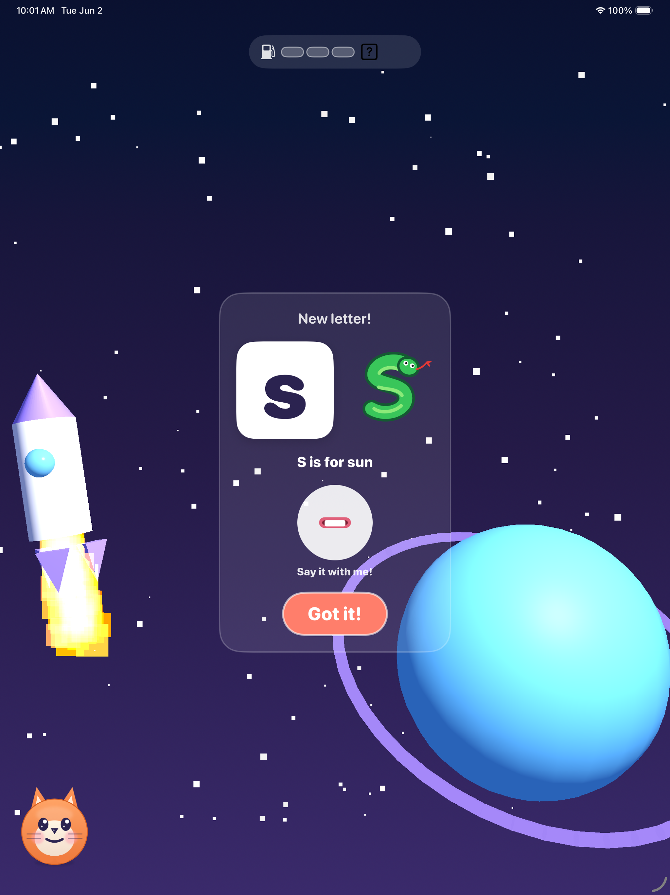

# Read Rocket Phonics

Read Rocket Phonics is a fully offline iPad app for beginning readers. Children practice letter sounds, blend sounds into words, spell, trace letters, and read decodable stories through short space-themed lessons.

[Download Read Rocket Phonics on the App Store](https://apps.apple.com/app/id6803603617)



## Features

- Systematic phonics lessons with reading and spelling practice
- Decodable stories and a built-in library
- Local child profiles, progress, review queues, and rewards
- US English, UK English, Greek, Spanish, French, Portuguese, European Portuguese, and German language worlds
- Original audio prompts, phoneme recordings, mnemonic art, and music
- No account, ads, subscription, in-app purchase, or network connection

## Requirements

- macOS with Xcode
- iPad or iPad Simulator running iOS 17 or later
- [XcodeGen](https://github.com/yonaskolb/XcodeGen) only if regenerating the Xcode project from `project.yml`

## Run

1. Open `ReadRocketPhonics.xcodeproj` in Xcode.
2. Select an iPad simulator.
3. Build and run the `ReadRocketPhonics` scheme.

To regenerate the project first:

```sh
xcodegen generate
open ReadRocketPhonics.xcodeproj
```

## Tests

Run the unit and UI tests from Xcode, or use:

```sh
xcodebuild test \
  -project ReadRocketPhonics.xcodeproj \
  -scheme ReadRocketPhonics \
  -destination 'platform=iOS Simulator,name=iPad Pro 11-inch (M4)'
```

## Privacy

The app works locally and stores progress in `UserDefaults` on the device. It does not require sign-in and does not collect user data.

Copyright Lore Hex. Source is provided for viewing and collaboration; no open-source license is granted unless a license file is added later.
